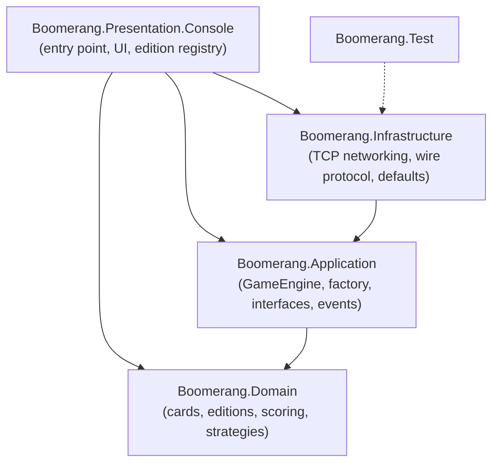

# Boomerang

A multiplayer, console-based implementation of a Boomerang-style card-drafting game (.NET 10). Players draft hands over several rounds, pass cards around the table, and score by rules defined per edition (e.g. Australia, Azeroth).

## Prerequisites

The .NET 10 SDK (Windows, macOS or Linux): https://dotnet.microsoft.com/download
Check the install with `dotnet --version`, which should print 10.x.

## Run a game

From the repository root:

```
dotnet run --project src/Boomerang.Presentation.Console
```

The menu offers 1 (host a game) or 2 (join a game).

Host: you are asked for the edition (`australia` or `azeroth`), the number of human players (including yourself) and the number of bots. The total must be 2 to 4, otherwise the game stops with an explanatory message. The host then waits for the other humans on TCP port 2048, so allow the port through the firewall if asked. Start the host before the clients.

Join: choose 2, then enter the host's address (`localhost` on the same machine).

Examples:
- Alone against one bot: choose 1, `australia`, 1 human, 1 bot.
- Two humans over the network: terminal A chooses 1, `australia`, 2 humans, 0 bots. Terminal B chooses 2, `localhost`.

During play, type the site letter of the card you want. For the activity question, type the number of your choice (0 scores nothing).

## Run the tests

```
dotnet test Boomerang.slnx
```

The run ends with a summary such as `Test summary: total: 94; failed: 0; succeeded: 94; skipped: 0; duration: 0,9s`, and the command exits with a non-zero code if any test fails. (The total grows as tests are added.)

To build or run without testing:

```
dotnet build Boomerang.slnx
dotnet run --project src/Boomerang.Presentation.Console
```

## Architecture



Dependencies point inward: `Domain` knows nothing about other projects, and `Application` knows only `Domain`. Infrastructure and presentation plug into interfaces defined in `Application`. The test project references only `Infrastructure` and reaches `Application` and `Domain` through it; it does not reference the console project.

## Project responsibilities

| Project | Responsibility |
| --- | --- |
| `src/Boomerang.Domain` | Pure game model. `Models` (Card, Region, Symbol), `Editions` (per-edition cards and rules, `IGameEdition`), `Scoring` (`IScoringRule`, `ScoreSheet`, round context/results), `Strategies` (`IPassingStrategy`, `IShuffler`), `Game` (results, winner selection, region bonus). No I/O. |
| `src/Boomerang.Application` | Game orchestration. `GameEngine` runs rounds using an edition, shuffler and passing strategy. `GameEngineFactory` builds an engine for an edition name via `IEditionResolver`. Defines the interfaces (`IEditionResolver`, `IPlayerInteraction`, `ITextChannel`, `IGameEventHandler<T>`, ...) that outer layers implement. |
| `src/Boomerang.Infrastructure` | Technical implementations: TCP server/client (`GameServer`, `GameClient`, `TcpTextChannel`), the wire protocol (`Wire`) and network defaults. Registers default services such as `IPassingStrategy`. |
| `src/Boomerang.Presentation.Console` | Executable. Program entry point, console rendering and input (`TextRenderer`, `TextPlayerInteraction`), event handlers, and the edition registry (`KeyedEditionResolver` configured in `DependencyInjection.cs`). |
| `tests/Boomerang.Test` | Unit tests for domain rules, the Australia edition data, engine behavior (exact scores with a small fake edition, pick sequence, hidden Throw card, pass direction) and the application layer (coordinator, bots, event publisher), with fakes in `Fakes/`. The TCP code (`GameServer`, `GameClient`, `Wire`) has no automated tests. |

## Key extension points

| Concern | Abstraction | Location |
| --- | --- | --- |
| Edition (cards, rounds, players, bonus) | `IGameEdition` | `Domain/Editions/Shared` |
| Scoring | `IScoringRule` | `Domain/Scoring` |
| Pass direction | `IPassingStrategy` | `Domain/Strategies` |
| Shuffling | `IShuffler` | `Domain/Strategies` |
| Edition lookup | `IEditionResolver` | `Application/Interfaces` |

Note: the passing strategy is currently registered globally (`PassNextStrategy`) and is not selectable per edition.

## Extension workflow

### Add a new edition

1. Create a folder `src/Boomerang.Domain/Editions/<Name>/`.
2. Add `<Name>Cards.cs` defining the cards (see `AustraliaCards.cs`, and `CardFactory` in `Editions/Shared`).
3. Add `<Name>Edition.cs` implementing `IGameEdition`: name, cards, regions, scoring rules, rounds, hand size, player limits, region bonus and tie-break category.
4. Reuse rules from `Editions/Shared/DefaultRules` where possible.
5. Register the edition in `src/Boomerang.Presentation.Console/DependencyInjection.cs`:
   ```csharp
   ["name"] = () => new NameEdition()
   ```
   The key is lowercase; `KeyedEditionResolver` lower-cases the requested edition name.
6. Add tests in `tests/Boomerang.Test/Domain`.

### Add a scoring rule

1. Implement `IScoringRule` in the edition's folder (edition-specific). `Evaluate(RoundContext)` returns a `RuleOutcome`.
2. Add it to the `ScoringRules` of the editions that use it.
3. Add a test in `tests/Boomerang.Test/Domain/RuleTests.cs`.

### Add a passing strategy

1. Implement `IPassingStrategy.DirectionFor(int roundIndex)` in `Domain/Strategies`.
2. Change the registration in `Infrastructure/DependencyInjection.cs`.

### Add an event handler or UI feature

1. Define or reuse an event in `Application/Events`.
2. Implement `IGameEventHandler<TEvent>` in the presentation project and register it in its `DependencyInjection.cs`.

### Add another front end or transport

Implement the `Application` interfaces in a new project and reference `Application` (and `Domain`). The engine and domain stay untouched.